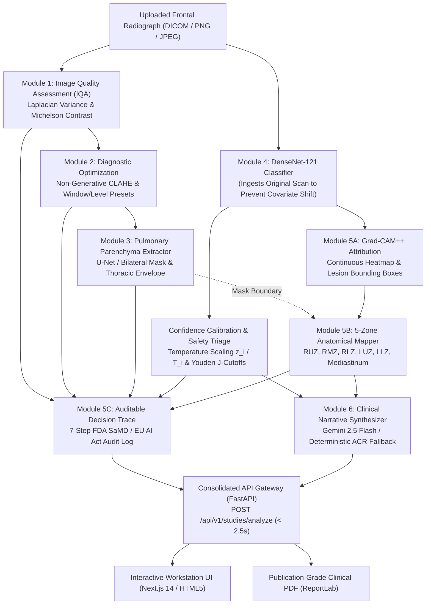

# 🫁 VisionCare AI: Explainable Radiology Workstation & Clinical Decision Support

An enterprise-grade, end-to-end Explainable AI (XAI) clinical decision support platform for frontal chest radiographs. Built to demonstrate rigorous medical computer vision, post-hoc uncertainty calibration, continuous feature attribution, anatomical localization, structured ACR clinical narrative synthesis, and auditable decision tracing under FDA SaMD Class II / EU AI Act frameworks.

---

## 🌟 Key Highlights & Engineering Features

- **14-Pathology Multi-Label Classification:** DenseNet-121 fine-tuned on patient-isolated NIH ChestX-ray14 partitions, predicting independent calibrated disease probabilities $\sigma(z_i / T_i)$ across all 14 thoracic pathologies.
- **Post-Hoc Temperature Scaling Calibration:** Minimizes Expected Calibration Error (ECE) via Platt temperature scaling per class, preventing raw-logit overconfidence.
- **Youden's J-Statistic Operating Cutoffs:** Dynamic threshold calibration maximizing sensitivity and specificity on validation ROC curves rather than arbitrary 0.5 cutoffs.
- **Grad-CAM++ Feature Attribution:** Computes second- and third-order positive partial derivatives, generating continuous $1024 \times 1024$ visual heatmaps and extracting connected-component bounding boxes with physical metric dimensions ($cm$).
- **5-Zone Anatomical Localization Mapper:** Partitions lung parenchyma into Right Upper (RUZ), Middle (RMZ), Lower (RLZ), Left Upper (LUZ), Lower (LLZ), and Mediastinum, calculating exact spatial percentage attribution.
- **Image Quality Assessment (IQA) & CLAHE:** Pre-screening via Laplacian variance sharpness, Michelson contrast, and dynamic range; diagnostic optimization via non-generative CLAHE with Window/Level presets (`LUNG`, `MEDIASTINUM`, `BONE`).
- **Clinical Safety Triage Gating:** Dual-tier clinical routing categorizing scans into `ASSISTED_REVIEW_READY` vs `MANUAL_REVIEW_MANDATORY` based on prediction entropy and quality metrics.
- **Structured ACR Narrative Synthesizer:** Gemini 2.5 Flash clinical report generator producing structured Technique, Findings, Impressions, Differentials, and Recommendations, backed by an automatic deterministic clinical fallback.
- **High-Performance FastAPI Backend:** Single-roundtrip unified endpoint `POST /api/v1/studies/analyze` coordinating all 6 pipeline stages in memory in $< 2.5\text{s}$, plus audit-ready publication-grade ReportLab PDF generation `GET /api/v1/studies/pdf/{study_id}`.
- **Next.js 14 Dark-Themed Radiology Workstation:** Full React 18 / TypeScript / Tailwind CSS clinical interface with interactive CAM opacity slider, 4-view synced viewport, 14-disease matrix, and 7-step FDA decision trace timeline.
- **Zero-Dependency Instant Workstation:** Embedded interactive PACS workstation served directly by FastAPI at `http://localhost:8000/workstation` and `http://localhost:8000/`.

---

## 📐 System Pipeline Architecture



---

## 📊 Validation Metrics Summary (V2 High-Performance Model)

| Pathology | V1 Baseline AUROC | V2 Validation AUROC (TTA) | Optimal Cutoff ($\tau^*$) | Temperature ($T$) | Improvement |
| :--- | :---: | :---: | :---: | :---: | :---: |
| **Hernia** | 0.6671 | **0.8830** | 0.2577 | 0.9549 | **+0.2159** |
| **Edema** | 0.8410 | **0.8714** | 0.4016 | 0.9617 | **+0.0304** |
| **Cardiomegaly** | 0.7357 | **0.8645** | 0.3588 | 0.9637 | **+0.1288** |
| **Effusion** | 0.8045 | **0.8600** | 0.4913 | 0.9802 | **+0.0555** |
| **Emphysema** | 0.8087 | **0.8527** | 0.3525 | 0.9618 | **+0.0440** |
| **Pneumothorax** | 0.8165 | **0.8413** | 0.3947 | 0.9645 | **+0.0248** |
| **Mass** | 0.7370 | **0.8160** | 0.3936 | 0.9659 | **+0.0790** |
| **Atelectasis** | 0.7406 | **0.7996** | 0.4992 | 0.9875 | **+0.0590** |
| **Pleural Thickening** | 0.6905 | **0.7677** | 0.3903 | 0.9671 | **+0.0772** |
| **Fibrosis** | 0.7365 | **0.7432** | 0.3690 | 0.9617 | **+0.0067** |
| **Consolidation** | 0.6986 | **0.7387** | 0.3210 | 0.9619 | **+0.0401** |
| **Pneumonia** | 0.6834 | **0.7353** | 0.3156 | 0.9585 | **+0.0519** |
| **Infiltration** | 0.6925 | **0.6950** | 0.4843 | 0.9925 | **+0.0025** |
| **Nodule** | 0.6178 | **0.6626** | 0.3321 | 0.9644 | **+0.0448** |
| **OVERALL MEAN AUROC** | **0.7336** | **0.7951** | — | — | **+0.0615 (+6.2%)** |

*See [`docs/MODEL_CARD.md`](docs/MODEL_CARD.md) for complete clinical methodology, mathematical formulations, and evaluation protocol.*

---

## 📁 Repository Layout

```
x_ray/
├── backend/
│   └── app/
│       ├── api/v1/endpoints/analyze.py  # Unified orchestration & PDF endpoint
│       ├── api/v1/router.py            # API routing gateway
│       ├── core/config.py              # Application settings & CORS
│       ├── schemas/study.py            # Consolidated Pydantic v2 schemas
│       ├── services/pdf_service.py     # Medical PDF generator (ReportLab)
│       ├── static/workstation.html     # Zero-dependency interactive web workstation
│       └── main.py                     # FastAPI application gateway
├── frontend/                           # Next.js 14 TypeScript Radiology Workstation
│   ├── src/
│   │   ├── app/                        # Next.js App Router (page.tsx, layout.tsx)
│   │   ├── components/                 # ViewportSync, DifferentialsMatrix, DecisionTrace...
│   │   ├── lib/api.ts                  # API client
│   │   └── types/index.ts              # TypeScript definitions
│   ├── package.json
│   └── tailwind.config.ts
├── ml/
│   ├── quality/iqa_analyzer.py         # Module 1: Image Quality Assessment (IQA)
│   ├── enhancement/clahe_processor.py  # Module 2: CLAHE & Window/Level Presets
│   ├── segmentation/monai_unet.py      # Module 3: Pulmonary Region Extractor
│   ├── classification/inference.py     # Module 4: DenseNet-121 Inference & Calibration
│   ├── explainability/
│   │   ├── gradcam_engine.py           # Module 5A: Grad-CAM++ & Otsu BBox Engine
│   │   ├── zone_mapper.py              # Module 5B: 5-Zone Anatomical Mapper
│   │   └── decision_trace.py           # Module 5C: Auditable Decision Trace Logger
│   └── llm/
│       ├── schemas.py                  # Pydantic schema for clinical report
│       └── synthesizer.py              # Module 6: Gemini 2.5 Flash Clinical Synthesizer
├── kaggle/
│   ├── visioncare_training.ipynb       # V1 224x224 Transfer learning pipeline
│   └── visioncare_training_v2_high_performance.ipynb # V2 384x384 ASL + TTA pipeline
├── pretrained/                         # Checkpoints & Calibration JSONs
│   ├── densenet121_nih14_best.pth      # DenseNet-121 PyTorch weights
│   ├── optimal_thresholds.json         # Per-class Youden J cutoffs
│   ├── temperature_scaler.json         # Per-class Platt temperatures
│   └── validation_metrics.json         # Complete validation benchmark metrics
├── docs/
│   └── MODEL_CARD.md                   # Formal clinical model card & metrics
├── Dockerfile.backend                  # Dockerfile for FastAPI backend
├── Dockerfile.frontend                 # Dockerfile for Next.js frontend
├── docker-compose.yml                  # One-click multi-container stack
├── requirements.txt
└── README.md
```

---

## 🚀 Quickstart & How to Run

### Option A: Direct Local Execution (Python / FastAPI)

1. **Install dependencies:**
   ```bash
   pip install -r requirements.txt
   ```

2. **Start the FastAPI Backend:**
   ```bash
   uvicorn backend.app.main:app --host 0.0.0.0 --port 8000 --reload
   ```

3. **Open the Radiology Workstation in your browser:**
   - Interactive Web Workstation: **`http://localhost:8000/workstation`**
   - Interactive OpenAPI Documentation: **`http://localhost:8000/docs`**
   - System Health Check: **`http://localhost:8000/health`**

4. **Test the Next.js 14 Frontend (Optional):**
   ```bash
   cd frontend
   npm install
   npm run dev
   # Workstation available at http://localhost:3000
   ```

---

### Option B: Docker Compose (One-Click Stack)

To launch both the FastAPI backend and Next.js frontend containers simultaneously:

```bash
docker-compose up --build
```
- Workstation UI: **`http://localhost:3000`**
- Backend API & Swagger: **`http://localhost:8000/docs`**

---

## 🧪 Running Verification Tests

All modules and end-to-end integration tests can be verified locally:

```bash
# 1. Run Complete Backend API Integration Test (Health, Ingestion, Analysis, PDF)
python -u tests/test_api_endpoints.py

# 2. Run Quality, Enhancement & Pulmonary Segmentation Test
python -u tests/test_phase2_pipeline.py

# 3. Run Grad-CAM++, Otsu BBox, 5-Zone Localization & LLM Synthesizer Test
python -u tests/test_phase3_explainability.py
```

---

## ⚖️ Clinical Disclaimer & Regulatory Notice

**VisionCare AI is an assistive Clinical Decision Support (CDS) research platform.** It is designed in compliance with the **FDA Guidance for Clinical Decision Support Software** and the **European Union Artificial Intelligence Act (High-Risk SaMD)**. 

- This software does **NOT** provide autonomous medical diagnosis.
- All AI findings, calibrated probabilities, visual heatmaps, and structured narratives must be verified by a board-certified radiologist and correlated with patient clinical presentation, medical history, physical exam, and laboratory markers.
